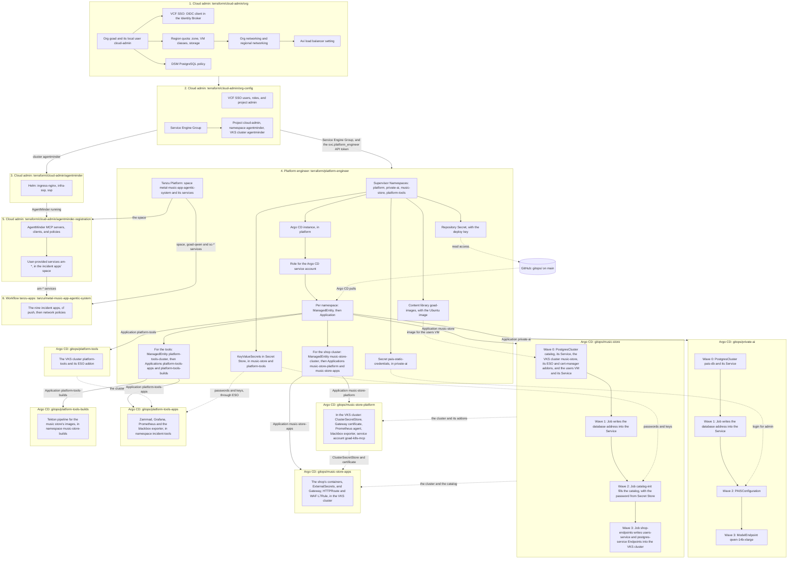

# The Grandmother of All Demos (GOAD)

This repository is the master for the GOAD demo. Manifests and the
walkthrough live here. Argo CD in the lab reads the manifests from
this GitHub repository directly. The lab's Gitea server holds only the
Terraform state.

The demo shows VMware Cloud Foundation across an application's life,
through four personas. Three of them are built so far: the cloud admin,
the platform engineer, and the developer.

| Persona | Tool | What it builds | Where |
|---|---|---|---|
| Cloud admin | Terraform | Stage 1: the org, VCF SSO, quota, networking, Avi load balancer, DSM policy | [terraform/cloud-admin/org](terraform/cloud-admin/org) |
| Cloud admin | Terraform | Stage 2: inside the org, the users and their roles, the Service Engine Group, and a project with a VKS cluster for AgentMinder | [terraform/cloud-admin/org-config](terraform/cloud-admin/org-config) |
| Cloud admin | Terraform | Stage 3: AgentMinder, installed on that cluster with Helm | [terraform/cloud-admin/agentminder](terraform/cloud-admin/agentminder) |
| Cloud admin | Terraform | Stage 4: the incident demo's agents and MCP servers registered in AgentMinder, and their clients handed to the apps as Cloud Foundry services | [terraform/cloud-admin/agentminder-registration](terraform/cloud-admin/agentminder-registration) |
| Platform engineer | Terraform | Supervisor Namespaces, the org's VM image, the secrets in Secret Store, Argo CD and the handoff to it, and the incident apps' Tanzu Platform space and services | [terraform/platform-engineer](terraform/platform-engineer) |
| Platform engineer | Argo CD | A DSM PostgreSQL database, Private AI Services, and the Qwen model | [gitops/private-ai](gitops/private-ai) |
| Platform engineer | Argo CD | The shop's DSM catalog database, its VKS cluster, its users VM, and the endpoints that point the VKS cluster at the VM and at the catalog | [gitops/music-store](gitops/music-store) |
| Platform engineer | Argo CD | Inside the shop's VKS cluster: the ESO store, the Gateway certificate, and what the platform tools cluster watches it with | [gitops/music-store-platform](gitops/music-store-platform) |
| Platform engineer | Argo CD | The platform tools VKS cluster, and in it the incident demo's Zammad, Grafana and Prometheus | [gitops/platform-tools](gitops/platform-tools), [gitops/platform-tools-apps](gitops/platform-tools-apps) |
| Platform engineer | Argo CD | The shop's containers, on the VKS cluster, published through Gateway API with Avi's WAF | [gitops/music-store-apps](gitops/music-store-apps) |
| Platform engineer | Argo CD, GitHub workflow `music-store-images` | The build of the shop's images: Tekton on the platform tools cluster, and a pull request with the new image tags | [gitops/platform-tools-builds](gitops/platform-tools-builds), [.github/workflows/music-store-images.yml](.github/workflows/music-store-images.yml) |
| Developer | Code | The shop's source: store, cart, orders, and chat | [apps/music-store](apps/music-store) |
| (incident demo) | GitHub workflow `tanzu-apps` | The incident agents and MCP servers, as Cloud Foundry apps on Tanzu Platform | [tanzu/metal-music-app-agentic-system](tanzu/metal-music-app-agentic-system) |

The music-store application, manifests and source, is in
[gitops/music-store-apps](gitops/music-store-apps). The developer
writes the application code in [apps/music-store](apps/music-store). The
developer does not build or deploy it. The platform engineer builds the
images (see below). The platform engineer deploys all of the music store with Argo CD:
the VKS cluster `music-store`, the catalog database, the users VM, and
the containers on that cluster (decision 45).

[gitops/music-store](gitops/music-store) is the DSM catalog, the VKS
cluster `music-store`, and the users VM. A Job writes the VM's address
and the catalog's address into Endpoints in the VKS cluster. No file
sets a namespace or an address. Terraform creates the `music-store`
namespace with the others, and Argo CD syncs that directory into it. The
shop login is `admin` / `admin`. The catalog Service is
`postgres-service`, which is the `DB_HOST` the containers already use.

[gitops/music-store-apps](gitops/music-store-apps) is the application
and its deploy. It goes into the namespace `music-store` of the VKS
cluster. It is the store, cart, orders, and chat. For now the shop runs
from the copy of the source in `src/`; the developer's code is in
`apps/music-store/`, and a later change switches the shop to the built
images and removes `src/`. The platform engineer owns the deploy, and the
developer owns `apps/music-store/`. The catalog password and the chat's model key are not in git.
They are GitHub secrets, which the platform engineer Terraform writes
into Secret Store; ESO in the cluster makes the Secrets `store-db` and
`metal-oracle-model` from them (decision 38).

[gitops/music-store-platform](gitops/music-store-platform) is the platform
engineer's part inside the VKS cluster: the `ClusterSecretStore` that ESO
reads Secret Store with, the self-signed wildcard certificate for the
shop's Gateway (decision 43), and the Prometheus agent and service account
the platform tools cluster uses to watch the shop.

The shop is published at `music.goad.gpu.set.lab` through Gateway API: the
Gateway `metal-store`, the HTTPRoute `metal-store-frontend`, and the
L7Rule `metal-store-waf`, which puts Avi's WAF policy on the route.

The incident demo's tools run on their own VKS cluster, `platform-tools`,
apart from the cluster they watch (decision 42).
[gitops/platform-tools](gitops/platform-tools) is the cluster, and
[gitops/platform-tools-apps](gitops/platform-tools-apps) is Zammad,
Grafana, Prometheus and the blackbox exporter in it. The incident apps
themselves are Cloud Foundry apps in
[tanzu/metal-music-app-agentic-system](tanzu/metal-music-app-agentic-system),
and `scripts/incident-walk.sh` starts a walk.

## Automation flow

Five Terraform roots, from a machine or from GitHub, then Argo CD and the
`tanzu-apps` workflow. An arrow means the first box is done before the
second one starts.



Solid arrows are that order. Dotted arrows are what one part reads from
another. After the handoff, Terraform does not touch what runs in
`private-ai`, `music-store`, `platform-tools`, and the clusters
`music-store` and `platform-tools`: a commit to `gitops/` on `main` is the
change.

`agentminder-registration` needs the space that the platform engineer
makes. On a first build the `cloud-admin` workflow runs before
`platform-engineer`, so its last job, `agentminder-registration`, fails
until `platform-engineer` has applied. Run `cloud-admin` again after it.

## Joining a demo that is already built

The lab is shared and the demo is running. To work on it from your
machine you do not build anything. You need the secrets that the team
shares, and nothing else that is not in git:

1. Get them from a teammate: the five `terraform.tfvars` files, the
   deploy key, and the state token. They come as one text to paste at
   the root of your clone. Put the cloud admin's files in
   `terraform/cloud-admin/org`, `terraform/cloud-admin/org-config`,
   `terraform/cloud-admin/agentminder`, and
   `terraform/cloud-admin/agentminder-registration`.
2. In `terraform/cloud-admin/org`, `terraform/cloud-admin/org-config`,
   `terraform/cloud-admin/agentminder`,
   `terraform/cloud-admin/agentminder-registration`, and
   `terraform/platform-engineer`:

   ```sh
   terraform init -backend-config=backend.hcl
   terraform plan
   ```

   In `terraform/cloud-admin/agentminder` and
   `terraform/cloud-admin/agentminder-registration`, also run
   `export TF_HTTP_PASSWORD=<the state token>` first. In
   `terraform/cloud-admin/agentminder-registration` and
   `terraform/platform-engineer`, also export `CF_ACCESS_TOKEN`, a Tanzu
   Platform access token for `goad-deployer`: the Cloud Foundry provider
   logs in with it. In `agentminder-registration`, never print the plan:
   follow [its README](terraform/cloud-admin/agentminder-registration/README.md).

3. All plans must show no changes. If one shows a change you did not
   make, stop: your files differ from the team's.
   [docs/terraform-state.md](docs/terraform-state.md) says which
   difference causes which change.

Do not create your own deploy key, password hash, or passwords.

That is all for the demo. `terraform/runner` is one more root, for the
runner that the GitHub workflows run on. You need it only to change the
runner. It has two more shared secrets, the vCenter password and the
GitHub App's private key: see
[terraform/runner/README.md](terraform/runner/README.md).

## Running Terraform from GitHub

The persona roots can also run in GitHub Actions, on a runner in the
lab. There is one Terraform workflow for each persona, and one workflow
that pushes the incident apps:

| Workflow | What it runs |
|---|---|
| `cloud-admin` | Four jobs, in order: `org` runs `terraform/cloud-admin/org`, then `org-config` runs `terraform/cloud-admin/org-config`, then `agentminder` runs `terraform/cloud-admin/agentminder`, then `agentminder-registration` runs `terraform/cloud-admin/agentminder-registration` |
| `platform-engineer` | `terraform/platform-engineer` |
| `tanzu-apps` | `cf push` of each app in `tanzu/metal-music-app-agentic-system`, then their network policies. See [its README](tanzu/metal-music-app-agentic-system/README.md) |

A Terraform workflow runs only when a person starts it. Nothing runs on a
pull request or on a push. In GitHub: Actions, the workflow, **Run
workflow**. Or:

```sh
gh workflow run cloud-admin.yml                 # plan
gh workflow run cloud-admin.yml -f apply=true   # plan, then apply
```

A run plans, and the plan is on the run's summary page. It applies only
with `apply`, and only on `main`: a run on another branch can plan and
cannot apply.

`tanzu-apps` runs on every push to `main` that changes
`tanzu/metal-music-app-agentic-system`, and by hand. It does not plan or
apply; it pushes.

Nothing orders the workflows. On a first build: `cloud-admin`, then
`platform-engineer`, then `cloud-admin` again (its last job needs the
space that `platform-engineer` makes), then `tanzu-apps`.

The workflows use the same state and the same shared secrets as a
machine does, so a run and a teammate's `terraform apply` are the same
thing. The secrets are repository secrets in GitHub.
[terraform/runner/README.md](terraform/runner/README.md) lists them and
says how the runner is built.
[Decision 25](docs/decisions.md) has the reasons.

## Quickstart

For a first build: from an empty org to the shop and the incident demo.
Most of the time is waiting for VKS clusters and the model.

### Before you start

The lab must already have:

- VCF Automation 9.1, with a region backed by a Supervisor.
- A Distributed VLAN Connection for the region, and a virtual network
  appliance cluster.
- Avi as the region's load balancer, in tenant managed mode.
- Data Services Manager (DSM) activated for the region, with an
  infrastructure policy and PostgreSQL 16 enabled.
- Private AI Services installed as a Supervisor Service, with the Qwen
  model and the engine image in the Supervisor's Harbor.
- A public proxy cache project, `tanzu-platform-content`, in the
  Supervisor's Harbor, for Broadcom's Tanzu Platform content registry
  and its Bitnami images.
- A public Harbor project, `music-store`, for the music store's images,
  and a robot account the platform engineer pushes them with.
- The Argo CD Supervisor Service, and Secret Store (the vault injector) on
  the Supervisor.
- The VKS addons `external-secrets` and `cert-manager` in the Supervisor's
  addon repository.
- Avi's `System-WAF-Policy`, set to enforcement if the shop's WAF must
  block.
- A Tanzu Platform foundation with the org `Goad`, and the Tanzu Hub
  account `goad-deployer` that the workflows log in as. The incident apps
  run there.

Your machine needs `terraform` 1.11 or later, `git`, `gh`, `openssl`, `curl`, `jq`, and
a network path to VCF Automation, to Tanzu Platform, and to the lab's Gitea server.

You need the password of the provider administrator (`admin` in the
`System` org), admin rights on this GitHub repository, and the token of
the Gitea user that holds the Terraform state: see "Terraform state".

### 1. Cloud admin: create the org

```sh
cd terraform/cloud-admin/org
cp terraform.tfvars.example terraform.tfvars
```

Two files hold the inputs:

- `lab.auto.tfvars`, in git: everything about the lab that is not
  secret. The region, the Distributed VLAN Connection, the zone and its
  limits, VM classes, storage, the DSM infrastructure policy, and the
  Harbor address. For a
  different lab, change this file and commit it.
- `terraform.tfvars`, not in git: `vcfa_password`, the provider
  administrator's password, `cloud_admin_password`, which Terraform sets
  for the org's one local user `cloud-admin`, `ops_password`, the
  VCF Operations administrator's password, `harbor_admin_password`, the
  Supervisor's Harbor administrator's password, and
  `broadcom_registry_username` and `broadcom_registry_token`, the
  Broadcom registry login of the Harbor proxy cache, and
  `music_store_robot_secret`, the secret of the music store's Harbor
  robot account. If the demo is already built,
  copy the team's file.

```sh
cp backend.hcl.example backend.hcl             # then put the state token in it
terraform init -backend-config=backend.hcl
terraform apply
```

It creates the org `goad`, its local user `cloud-admin` (Organization
Administrator), VCF SSO for the org, quota, networking, the Avi setting,
and the DSM policy. If the last line of the plan warns that regional
networking is not realized, wait a minute and run `terraform plan` until
the warning is gone.

The VCF SSO part makes the org's OIDC client in the VCF Identity Broker
through VCF Operations' internal API, which is unsupported and can change
in another release. See [decision 27](docs/decisions.md).

### 1b. Cloud admin: configure the org

```sh
cd ../org-config
cp terraform.tfvars.example terraform.tfvars   # cloud_admin_password, the same as in org
cp backend.hcl.example backend.hcl             # then put the state token in it
terraform init -backend-config=backend.hcl
terraform apply
```

It logs in to the org as `cloud-admin` and imports from VCF SSO the AD
group `ans-platform-engineer@set.lab`, whose members become admins of the
project `default-project`, and the AD service account
`svc.platform_engineer@set.lab`. It also creates the Service Engine
Group, the project `kro-authors` for kro APIs, the project `cloud-admin`,
a namespace in it, and the VKS cluster `agentminder`. The cluster takes a
while to come up.

### 1c. Cloud admin: install AgentMinder

```sh
cd ../agentminder
cp terraform.tfvars.example terraform.tfvars   # cloud_admin_password and the registry login
cp backend.hcl.example backend.hcl             # then put the state token in it
export TF_HTTP_PASSWORD=<the same token>       # the remote state read cannot use backend.hcl
terraform init -backend-config=backend.hcl
terraform apply
```

It reads the cluster from the state of `org-config` and installs
`ingress-nginx` and AgentMinder with Helm. AgentMinder is installed
small: [decision 30](docs/decisions.md). Its agents are registered later,
in step 5. Avi DNS makes the record for
`agentminder.goad.gpu.set.lab` by itself: see decision 31.

### 2. Give Argo CD read access to this repository

A read-only deploy key.

**If the demo is already built, do not do this step.** The key exists and
the team shares it. Get the file
`terraform/platform-engineer/.secrets/gitops-deploy-key` from a
teammate. A new key of your own would replace the one Argo CD uses, and
Argo CD would stop reading git.

Only for a first build, once, from the repository root:

```sh
mkdir -p terraform/platform-engineer/.secrets
ssh-keygen -t ed25519 -N '' -f terraform/platform-engineer/.secrets/gitops-deploy-key
gh repo deploy-key add terraform/platform-engineer/.secrets/gitops-deploy-key.pub \
  --repo modern-apps-5/the-goad --title goad-argocd-read
```

`.secrets/` is ignored by git. If GitHub answers "Deploy keys are
disabled for this repository", an organization owner must enable them in
the organization's settings.

### 3. Platform engineer: namespaces, Argo CD, handoff

Make the API token first, once, by hand: log in to the org `goad` with
VCF SSO as `svc.platform_engineer@set.lab`, then User Preferences, API
Tokens. A new AD user can log in only after the Identity Broker syncs the
directory (VCF Operations, Fleet Management, Identity & Access, VCF SSO).
If the demo is already built, the team's `terraform.tfvars` has the token.

```sh
cd terraform/platform-engineer
cp terraform.tfvars.example terraform.tfvars
```

Again two files:

- `lab.auto.tfvars`, in git: the region, zone, VPC, storage class, and
  the path of the deploy key.
- `terraform.tfvars`, not in git: `vcfa_api_token`, the API token above;
  `pais_admin_password_hash`, the output of `openssl passwd -6` for the
  Private AI Services user `admin`; the music store's and the platform
  tools' passwords and keys, which Terraform writes to Secret Store; and
  the incident apps' keys for their Cloud Foundry services. In GitHub
  each is a repository secret: `terraform.tfvars.example` names them. If
  the demo is already built, copy the team's file.

```sh
cp backend.hcl.example backend.hcl
export CF_ACCESS_TOKEN=<a Tanzu Platform token for goad-deployer>
terraform init -backend-config=backend.hcl
terraform apply
```

It creates the namespaces `platform-xxxxx`, `private-ai-xxxxx`,
`music-store-xxxxx`, and `platform-tools-xxxxx`, and the Argo CD
instance. For each namespace other than `platform` it creates one Argo CD
Application that syncs `gitops/<namespace key>/` into it. It registers
the VKS clusters `music-store` and `platform-tools` with Argo CD and
creates the Applications that sync into them. It writes the secrets into
Secret Store as `KeyValueSecret`s (decision 38). It also creates the
content library `goad-images` and uploads the Ubuntu image to it, for
the users VM. The first apply downloads about 570 MiB with `curl`, so the
machine needs internet access to cloud-images.ubuntu.com.

On Tanzu Platform it creates the space `metal-music-app-agentic-system`
in org `Goad`, and the user-provided services `goad-qwen` and `sc-*` that
the incident apps bind (decision 40).

`terraform output namespaces` prints the generated namespace names.

### 4. Argo CD: database, Private AI Services, model, and the shop

Nothing to run. Argo CD syncs `gitops/private-ai/` from `main` in waves
and waits for each to be healthy:

| Wave | Resource | Typical time |
|---|---|---|
| 0 | DSM `PostgresCluster` `pais-db`, and its Service | 5 minutes |
| 1 | The Job that points the Service at the database | under a minute |
| 2 | `PAISConfiguration` | 3 minutes |
| 3 | `ModelEndpoint` `qwen-14b-xlarge`, routing name `qwen` | a few minutes, for the model load |

DSM assigns the database its address when it creates it. Nothing in git
holds that address: Private AI Services connects to the Service name
`pais-db`, and the Job in wave 1 writes the address into the Service's
Endpoints.

Argo CD syncs `gitops/music-store/` the same way, into the `music-store`
namespace: the catalog database and the VKS cluster `music-store` with its
ESO and cert-manager addons, with the same kind of Service name in front
of the database. The cluster takes about 15 minutes to build. Then
`music-store-platform` puts the `ClusterSecretStore` and the Gateway's
certificate in the cluster.

The same Application creates the users VM in that namespace, in wave 0.
In wave 3, after the catalog is filled and the cluster is healthy, a Job
writes the VM's address and the catalog's address into Endpoints in the
VKS cluster. Argo CD then syncs `gitops/music-store-apps/` as the
platform engineer. The Application `music-store-apps` deploys the
containers onto the cluster. It depends on the cluster and the catalog,
so it retries until those exist. The developer writes only the code in
`gitops/music-store-apps/src/`.

Argo CD syncs `gitops/platform-tools/` into the `platform-tools`
namespace: the VKS cluster `platform-tools` and its ESO addon. Then
`platform-tools-apps` puts Zammad, Grafana, Prometheus and the blackbox
exporter in it, in namespace `incident-tools`. `platform-tools/` also
installs the Tekton addon. The Application `platform-tools-builds` syncs
`gitops/platform-tools-builds/` into the namespace `music-store-builds`
of that cluster: the pipeline that builds the music store's images from
`apps/music-store/`, with the Dockerfile template the platform engineer
owns. The workflow `music-store-images.yml` starts a PipelineRun and
opens a pull request with the new image tags
(`depot.kube-system.svc/music-store/<service>:<commit>`, decision 48).

### 5. Cloud admin: register the incident agents in AgentMinder

Needs the space from step 3.

```sh
cd terraform/cloud-admin/agentminder-registration
cp terraform.tfvars.example terraform.tfvars   # cloud_admin_password, the same as in org
cp backend.hcl.example backend.hcl             # then put the state token in it
export TF_HTTP_PASSWORD=<the same token>
export CF_ACCESS_TOKEN=<a Tanzu Platform token for goad-deployer>
terraform init -backend-config=backend.hcl
```

Then plan and apply as its
[README](terraform/cloud-admin/agentminder-registration/README.md) says,
without printing the plan: the plan can show client secrets. It creates
the MCP servers and clients in AgentMinder, and the services `am-*` that
hand each diagnostic agent its client.

### 6. Push the incident apps

Zammad starts empty. Create its admin and the walk tickets' organization,
then store the admin's API token as the GitHub secret
`INCIDENT_ZAMMAD_TOKEN`: see [gitops/README.md](gitops/README.md). Then
run the `tanzu-apps` workflow, or push a change under
`tanzu/metal-music-app-agentic-system`.
[Its README](tanzu/metal-music-app-agentic-system/README.md) lists the
GitHub secrets it reads and how to start a walk.

### 7. Check it

- **VCF Automation**, as a member of `ans-platform-engineer@set.lab`
  (for example `william.arroyo@set.lab`) in the org `goad`: four
  namespaces in the default project.
- **Argo CD**: the address is the `externalIP` in the status of the
  `ArgoCD` object in the `platform` namespace. Log in with "VCF
  Automation" as the same user. The Application `private-ai` is
  `Synced` and `Healthy`. On a first deploy the page answers only after
  Avi has started its Service Engines.
- **Private AI Services**: the address is the external IP of the Service
  `pais-ingress-default` in the `private-ai` namespace. Log in as
  `admin`. The model `qwen` is listed and ready.
- **AgentMinder**: `kubectl -n ssp get pods` on the cluster
  `agentminder` shows every pod running. Then
  `https://agentminder.goad.gpu.set.lab` answers.
- **VKS clusters**: the Cluster `music-store` in the `music-store`
  namespace and the Cluster `platform-tools` in the `platform-tools`
  namespace are Available (`kubectl get clusters` in each namespace).
- **The shop**: `https://music.goad.gpu.set.lab` answers, with a
  self-signed certificate.
- **The incident tools**: `http://zammad.goad.gpu.set.lab` and
  `http://grafana.goad.gpu.set.lab` answer.
- **The incident apps**: `cf apps` in org `Goad`, space
  `metal-music-app-agentic-system`, shows nine apps running.
- **Terraform**: `terraform plan` in each root shows no changes.

### Tear down

Reverse order. `agentminder-registration` first: it needs the running
AgentMinder to delete its objects, and its services are in the platform
engineer's space. Then the platform engineer, because its namespaces use
the Service Engine Group, and the org cannot be deleted while it has
namespaces and a Service Engine Group. Then `agentminder`, because its
cluster must exist for Helm to remove what it installed. Then
`org-config`, then `org`.

```sh
cd terraform/cloud-admin/agentminder-registration && terraform destroy
cd ../../platform-engineer && terraform destroy
cd ../cloud-admin/agentminder && terraform destroy
cd ../org-config && terraform destroy
cd ../org && terraform destroy
```

Deleting a namespace deletes what Argo CD put in it: for `private-ai`,
the database, Private AI Services, and the model; for `music-store` and
`platform-tools`, their VKS clusters.

## Terraform state

State is remote, in the Terraform state registry of the lab's Gitea
server, under the organization `the-goad`. Terraform's `http` backend
talks to it, with locking. Gitea keeps every version of the state.

| Root | State name |
|---|---|
| `terraform/cloud-admin/org` | `goad-cloud-admin` |
| `terraform/cloud-admin/org-config` | `goad-cloud-admin-org-config` |
| `terraform/cloud-admin/agentminder` | `goad-cloud-admin-agentminder` |
| `terraform/cloud-admin/agentminder-registration` | `goad-cloud-admin-agentminder-registration` |
| `terraform/platform-engineer` | `goad-platform-engineer` |
| `terraform/runner` | `goad-runner` |

`backend.tf` in each root holds the address and the settings, in git.
The one secret, the token of the shared Gitea user `goad-terraform`, is
in `backend.hcl`, which git ignores. A token cannot be a Terraform
variable: the backend is read before any variable is.

To set up a machine, in each root: copy `backend.hcl.example` to
`backend.hcl`, put the token in it, then run
`terraform init -backend-config=backend.hcl`. Get the token from a
teammate, never through git or email.

The state holds passwords and a private key. Anyone with that token can
read them.

[docs/terraform-state.md](docs/terraform-state.md) has the full setup,
what to do when it goes wrong, and how to go back to an earlier state.

## Layout

```
terraform/cloud-admin/org/     Stage 1, provider (System) org scope: creates the org
terraform/cloud-admin/org-config/  Stage 2, inside the org: users, roles, Service Engine Group, kro-authors, AgentMinder's cluster
terraform/cloud-admin/agentminder/ Stage 3, AgentMinder on that cluster, with Helm
terraform/cloud-admin/agentminder-registration/ Stage 4, the incident demo's agents registered in AgentMinder
terraform/platform-engineer/   Inside the org: namespaces, Secret Store, Argo CD handoff, Tanzu Platform space
  manifests/                   Manifests that Terraform applies
terraform/runner/              The self-hosted runner for the workflows. Not a persona; applied by hand
gitops/<namespace key>/        What Argo CD syncs into that namespace: private-ai, music-store, platform-tools
gitops/music-store-platform/   The platform engineer's part inside the music-store VKS cluster
apps/music-store/              The developer's code: store, cart, order, chat. The platform engineer builds it into images
gitops/music-store-apps/       The shop's containers, deployed into the VKS cluster by the platform engineer; src/ is the copy the shop runs until the switch to the images
gitops/platform-tools-builds/  The image build: Tekton pipeline, tasks, and the Dockerfile template, in the platform tools cluster
gitops/platform-tools-apps/    What runs in the platform tools cluster: the incident demo's Zammad, Grafana, Prometheus
tanzu/<space>/                 Cloud Foundry apps that tanzu-apps.yml pushes into that space of org Goad
scripts/                       What a person runs by hand: setup once, the SDK mirror, and the incident walk
.github/workflows/             One Terraform workflow for each persona, tanzu-apps.yml, and music-store-images.yml
.github/actions/cf-login/      Installs the cf CLI and logs in to Tanzu Platform as goad-deployer
.github/actions/cf-token/      Gets a Tanzu Platform token for goad-deployer, for Terraform
docs/                          Design, script, plan, decisions
```

One rule decides where a file goes: if Terraform applies it, it is under
`terraform/`. If Argo CD syncs it, it is under `gitops/`. If `cf push`
pushes it, it is under `tanzu/`. If a person runs it, it is under
`scripts/`.

To give Argo CD another namespace, add it to `namespaces` in
`terraform/platform-engineer` and add the directory `gitops/<key>/`.
`music-store` and `platform-tools` were added that way. Manifests under
`gitops/<namespace key>/` do not set a namespace. A directory that syncs
into a VKS cluster has its own `ManagedEntity` and Application in
`terraform/platform-engineer/gitops.tf`.

## Things to know

- **Lab values are in git, secrets are not.** `lab.auto.tfvars` in each
  root is committed, so everyone applies with the same lab values.
  `terraform.tfvars`, `backend.hcl`, and `.secrets/` are ignored by git.
- **The secret files are shared, not personal.** State is shared, so
  everyone must apply with the same passwords, the same deploy key, and
  the same password hash. Copy them from a teammate; do not make your
  own. With different values, each apply undoes the last person's.
  [docs/terraform-state.md](docs/terraform-state.md) lists what breaks.
- **The lab is shared.** `terraform apply` and `terraform destroy` in
  `cloud-admin/org` create and delete a real org.
- **No GPU.** The model runs on CPU. Do not say GPU on camera until one
  is allocated.
- **This repository is tied to one lab.** `lab.auto.tfvars`,
  `backend.tf`, and the manifests in `gitops/` name this lab's VCF
  Automation and Gitea addresses, region, storage policy, and DSM
  infrastructure policy. For another lab, change those and commit.
- **AgentMinder needs a registry login.** Its images come from Broadcom's
  registry. `terraform/cloud-admin/agentminder` takes the login as
  `ssp_registry_username` and `ssp_registry_password`. Copy the team's
  `terraform.tfvars`.
- **The lab pulls public images.** The Jobs in `gitops/` use `alpine/k8s`
  and `postgres` from Docker Hub.

## Documents

| Document | What it is |
|---|---|
| [docs/master-design-v5.md](docs/master-design-v5.md) | Design V5, transcribed from the current plan |
| [docs/walkthrough-script.md](docs/walkthrough-script.md) | The five-video script, including the unfinished beats |
| [docs/execution-plan.md](docs/execution-plan.md) | Suggested order of work |
| [docs/decisions.md](docs/decisions.md) | Choices made while building, and why |
| [docs/terraform-state.md](docs/terraform-state.md) | Where Terraform state is, and how to set up a machine for it |
| [CHANGELOG.md](CHANGELOG.md) | What changed, newest first |
| [terraform/runner/README.md](terraform/runner/README.md) | The self-hosted runner that the workflows run on, and how to build it |
| [terraform/cloud-admin/org/README.md](terraform/cloud-admin/org/README.md) | The cloud admin Terraform, stage 1 (the org), in detail |
| [terraform/cloud-admin/org-config/README.md](terraform/cloud-admin/org-config/README.md) | The cloud admin Terraform, stage 2 (inside the org), in detail |
| [terraform/cloud-admin/agentminder/README.md](terraform/cloud-admin/agentminder/README.md) | The cloud admin Terraform, stage 3 (AgentMinder), in detail |
| [terraform/cloud-admin/agentminder-registration/README.md](terraform/cloud-admin/agentminder-registration/README.md) | The cloud admin Terraform, stage 4 (AgentMinder registration), in detail |
| [terraform/platform-engineer/README.md](terraform/platform-engineer/README.md) | The platform engineer Terraform in detail |
| [gitops/README.md](gitops/README.md) | Each gitops directory, its owner and Application, and how host names are published |
| [tanzu/metal-music-app-agentic-system/README.md](tanzu/metal-music-app-agentic-system/README.md) | The incident demo's Cloud Foundry apps, their secrets, and how to run a walk |
