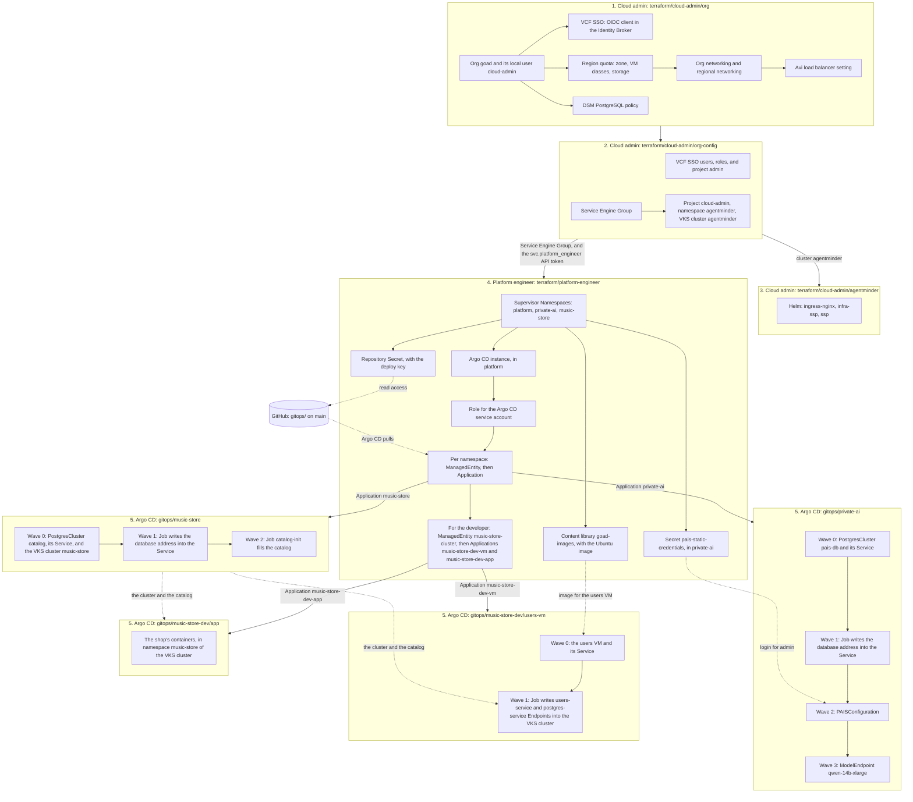

# The Grandmother of All Demos (GOAD)

This repository is the master for the GOAD demo. Manifests and the
walkthrough live here. A lab git server pulls a replica from this
remote.

The demo shows VMware Cloud Foundation across an application's life,
through four personas. Three of them are built so far: the cloud admin,
the platform engineer, and the developer.

| Persona | Tool | What it builds | Where |
|---|---|---|---|
| Cloud admin | Terraform | Stage 1: the org, VCF SSO, quota, networking, Avi load balancer, DSM policy | [terraform/cloud-admin/org](terraform/cloud-admin/org) |
| Cloud admin | Terraform | Stage 2: inside the org, the users and their roles, the Service Engine Group, and a project with a VKS cluster for AgentMinder | [terraform/cloud-admin/org-config](terraform/cloud-admin/org-config) |
| Cloud admin | Terraform | Stage 3: AgentMinder, installed on that cluster with Helm | [terraform/cloud-admin/agentminder](terraform/cloud-admin/agentminder) |
| Platform engineer | Terraform | Supervisor Namespaces, the org's VM image, Argo CD, and the handoff to it | [terraform/platform-engineer](terraform/platform-engineer) |
| Platform engineer | Argo CD | A DSM PostgreSQL database, Private AI Services, and the Qwen model | [gitops/private-ai](gitops/private-ai) |
| Platform engineer | Argo CD | The shop's DSM catalog database and its VKS cluster | [gitops/music-store](gitops/music-store) |
| Developer | Argo CD | The shop's users VM, and the endpoints that point the VKS cluster at it and at the catalog | [gitops/music-store-dev/users-vm](gitops/music-store-dev/users-vm) |
| Developer | Argo CD | The shop's containers, on the VKS cluster | [gitops/music-store-dev/app](gitops/music-store-dev/app) |

The music-store application is in [app/music-store](app/music-store) as
plain container manifests. The platform engineer builds the VKS cluster
`music-store` and the catalog database. The developer deploys the
containers onto that cluster, and the users VM next to it.

[gitops/music-store](gitops/music-store) is the DSM catalog and the VKS
cluster `music-store`. No file sets a namespace or an address. Terraform
creates the `music-store` namespace with the others, and Argo CD syncs
that directory into it. The shop login is `admin` / `admin`. The catalog
Service is `postgres-service`, which is the `DB_HOST` the containers
already use.

[gitops/music-store-dev](gitops/music-store-dev) is the developer's
part. It has two directories, and Argo CD syncs each one to a different
place:

- `users-vm/` goes into the `music-store` Supervisor Namespace. It is the
  users VM, and a Job that writes the VM's address and the catalog's
  address into Endpoints in the VKS cluster.
- `app/` goes into the namespace `music-store` of the VKS cluster. It is
  the store, cart, orders, and traffic generator from
  [app/music-store](app/music-store). The chat service is not deployed
  there. The walkthrough deploys it to Tanzu with `cf push`.

## Automation flow

Four Terraform applies, from a machine or from GitHub, then Argo CD. An arrow means the first box is
done before the second one starts.



Solid arrows are that order. Dotted arrows are what one part reads from
another. After the handoff, Terraform does not touch what runs in
`private-ai`, `music-store`, and the cluster `music-store`: a commit to
`gitops/` on `main` is the change.

## Joining a demo that is already built

The lab is shared and the demo is running. To work on it from your
machine you do not build anything. You need the secrets that the team
shares, and nothing else that is not in git:

1. Get them from a teammate: the four `terraform.tfvars` files, the
   deploy key, and the state token. They come as one text to paste at
   the root of your clone. Put the cloud admin's files in
   `terraform/cloud-admin/org`, `terraform/cloud-admin/org-config`, and
   `terraform/cloud-admin/agentminder`.
2. In `terraform/cloud-admin/org`, `terraform/cloud-admin/org-config`,
   `terraform/cloud-admin/agentminder`, and `terraform/platform-engineer`:

   ```sh
   terraform init -backend-config=backend.hcl
   terraform plan
   ```

   In `terraform/cloud-admin/agentminder`, also run
   `export TF_HTTP_PASSWORD=<the state token>` first.

3. All plans must show no changes. If one shows a change you did not
   make, stop: your files differ from the team's.
   [docs/terraform-state.md](docs/terraform-state.md) says which
   difference causes which change.

Do not create your own deploy key, password hash, or passwords.

That is all for the demo. `terraform/runner` is a third root, for the
runner that the GitHub workflows run on. You need it only to change the
runner. It has two more shared secrets, the vCenter password and the
GitHub App's private key: see
[terraform/runner/README.md](terraform/runner/README.md).

## Running Terraform from GitHub

The persona roots can also run in GitHub Actions, on a runner in the
lab. There is one workflow for each persona:

| Workflow | Root |
|---|---|
| `cloud-admin` | Three jobs, in order: `org` runs `terraform/cloud-admin/org`, then `org-config` runs `terraform/cloud-admin/org-config`, then `agentminder` runs `terraform/cloud-admin/agentminder` |
| `platform-engineer` | `terraform/platform-engineer` |

A workflow runs only when a person starts it. Nothing runs on a pull
request or on a push. In GitHub: Actions, the workflow, **Run workflow**.
Or:

```sh
gh workflow run cloud-admin.yml                 # plan
gh workflow run cloud-admin.yml -f apply=true   # plan, then apply
```

A run plans, and the plan is on the run's summary page. It applies only
with `apply`, and only on `main`: a run on another branch can plan and
cannot apply.

Nothing orders the two workflows. On a first build, let `cloud-admin`
finish, then start `platform-engineer`.

The workflows use the same state and the same shared secrets as a
machine does, so a run and a teammate's `terraform apply` are the same
thing. The secrets are repository secrets in GitHub.
[terraform/runner/README.md](terraform/runner/README.md) lists them and
says how the runner is built.
[Decision 25](docs/decisions.md) has the reasons.

## Quickstart

For a first build: from an empty org to a served model. About 20
minutes, most of it waiting.

### Before you start

The lab must already have:

- VCF Automation 9.1, with a region backed by a Supervisor.
- A Distributed VLAN Connection for the region, and a virtual network
  appliance cluster.
- Avi as the region's load balancer, in tenant managed mode.
- Data Services Manager (DSM) activated for the region, with an
  infrastructure policy and PostgreSQL 16 enabled.
- Private AI Services installed as a Supervisor Service, with the Qwen
  model and the engine image in the Supervisor's Harbor.
- The Argo CD Supervisor Service.

Your machine needs `terraform` 1.11 or later, `git`, `gh`, `openssl`, `curl`, and
a network path to VCF Automation and to the lab's Gitea server.

You need the password of the provider administrator (`admin` in the
`System` org), admin rights on this GitHub repository, and the token of
the Gitea user that holds the Terraform state: see "Terraform state".

### 1. Cloud admin: create the org

```sh
cd terraform/cloud-admin/org
cp terraform.tfvars.example terraform.tfvars
```

Two files hold the inputs:

- `lab.auto.tfvars`, in git: everything about the lab that is not
  secret. The region, the Distributed VLAN Connection, the zone and its
  limits, VM classes, storage, and the DSM infrastructure policy. For a
  different lab, change this file and commit it.
- `terraform.tfvars`, not in git: `vcfa_password`, the provider
  administrator's password, `cloud_admin_password`, which Terraform sets
  for the org's one local user `cloud-admin`, and `ops_password`, the
  VCF Operations administrator's password. If the demo is already built,
  copy the team's file.

```sh
cp backend.hcl.example backend.hcl             # then put the state token in it
terraform init -backend-config=backend.hcl
terraform apply
```

It creates the org `goad`, its local user `cloud-admin` (Organization
Administrator), VCF SSO for the org, quota, networking, the Avi setting,
and the DSM policy. If the last line of the plan warns that regional
networking is not realized, wait a minute and run `terraform plan` until
the warning is gone.

The VCF SSO part makes the org's OIDC client in the VCF Identity Broker
through VCF Operations' internal API, which is unsupported and can change
in another release. See [decision 27](docs/decisions.md).

### 1b. Cloud admin: configure the org

```sh
cd ../org-config
cp terraform.tfvars.example terraform.tfvars   # cloud_admin_password, the same as in org
cp backend.hcl.example backend.hcl             # then put the state token in it
terraform init -backend-config=backend.hcl
terraform apply
```

It logs in to the org as `cloud-admin` and imports the VCF SSO users:
the platform engineers, who become admins of the project
`default-project`, and the AD service account
`svc.platform_engineer@set.lab`. It also creates the Service Engine
Group, the project `cloud-admin`, a namespace in it, and the VKS cluster
`agentminder`. The cluster takes a while to come up.

### 1c. Cloud admin: install AgentMinder

```sh
cd ../agentminder
cp terraform.tfvars.example terraform.tfvars   # cloud_admin_password and the registry login
cp backend.hcl.example backend.hcl             # then put the state token in it
export TF_HTTP_PASSWORD=<the same token>       # the remote state read cannot use backend.hcl
terraform init -backend-config=backend.hcl
terraform apply
```

It reads the cluster from the state of `org-config` and installs
`ingress-nginx` and AgentMinder with Helm. AgentMinder is installed
small, with no agents configured:
[decision 30](docs/decisions.md). Avi DNS makes the record for
`agentminder.goad.gpu.set.lab` by itself: see decision 31.

### 2. Give Argo CD read access to this repository

A read-only deploy key.

**If the demo is already built, do not do this step.** The key exists and
the team shares it. Get the file
`terraform/platform-engineer/.secrets/gitops-deploy-key` from a
teammate. A new key of your own would replace the one Argo CD uses, and
Argo CD would stop reading git.

Only for a first build, once, from the repository root:

```sh
mkdir -p terraform/platform-engineer/.secrets
ssh-keygen -t ed25519 -N '' -f terraform/platform-engineer/.secrets/gitops-deploy-key
gh repo deploy-key add terraform/platform-engineer/.secrets/gitops-deploy-key.pub \
  --repo modern-apps-5/the-goad --title goad-argocd-read
```

`.secrets/` is ignored by git. If GitHub answers "Deploy keys are
disabled for this repository", an organization owner must enable them in
the organization's settings.

### 3. Platform engineer: namespaces, Argo CD, handoff

Make the API token first, once, by hand: log in to the org `goad` with
VCF SSO as `svc.platform_engineer@set.lab`, then User Preferences, API
Tokens. A new AD user can log in only after the Identity Broker syncs the
directory (VCF Operations, Fleet Management, Identity & Access, VCF SSO).
If the demo is already built, the team's `terraform.tfvars` has the token.

```sh
cd terraform/platform-engineer
cp terraform.tfvars.example terraform.tfvars
```

Again two files:

- `lab.auto.tfvars`, in git: the region, zone, VPC, storage class, and
  the path of the deploy key.
- `terraform.tfvars`, not in git: `vcfa_api_token`, the API token above,
  and `pais_admin_password_hash`, the
  output of `openssl passwd -6` for the Private AI Services user
  `admin`. If the demo is already built, copy the team's file.

```sh
cp backend.hcl.example backend.hcl
terraform init -backend-config=backend.hcl
terraform apply
```

It creates the namespaces `platform-xxxxx`,
`private-ai-xxxxx`, and `music-store-xxxxx`, and the Argo CD instance.
For each namespace other than `platform` it creates one Argo CD
Application that syncs `gitops/<namespace key>/` into it. It also creates
the content library `goad-images` and uploads the Ubuntu image to it, for
the users VM. The first apply downloads about 570 MiB with `curl`, so the
machine needs internet access to cloud-images.ubuntu.com.

`terraform output namespaces` prints the generated namespace names.

### 4. Argo CD: database, Private AI Services, model, and the shop

Nothing to run. Argo CD syncs `gitops/private-ai/` from `main` in waves
and waits for each to be healthy:

| Wave | Resource | Typical time |
|---|---|---|
| 0 | DSM `PostgresCluster` `pais-db`, and its Service | 5 minutes |
| 1 | The Job that points the Service at the database | under a minute |
| 2 | `PAISConfiguration` | 3 minutes |
| 3 | `ModelEndpoint` `qwen` | 1 minute |

DSM assigns the database its address when it creates it. Nothing in git
holds that address: Private AI Services connects to the Service name
`pais-db`, and the Job in wave 1 writes the address into the Service's
Endpoints.

Argo CD syncs `gitops/music-store/` the same way, into the `music-store`
namespace: the catalog database and the VKS cluster `music-store`, with
the same kind of Service name in front of the database. The cluster takes
about 15 minutes to build.

Argo CD then syncs `gitops/music-store-dev/` as the developer. The
Application `music-store-dev-vm` creates the users VM in the same
namespace, and a Job writes the VM's address and the catalog's address
into Endpoints in the VKS cluster. The Application `music-store-dev-app`
deploys the containers onto the cluster. Both depend on the cluster and
the catalog, so they retry until those exist.

### 5. Check it

- **VCF Automation**, as a member of `ans-platform-engineer@set.lab`
  (for example `william.arroyo@set.lab`) in the org `goad`: three
  namespaces in the default project.
- **Argo CD**: the address is the `externalIP` in the status of the
  `ArgoCD` object in the `platform` namespace. Log in with "VCF
  Automation" as the same user. The Application `private-ai` is
  `Synced` and `Healthy`. On a first deploy the page answers only after
  Avi has started its Service Engines.
- **Private AI Services**: the address is the external IP of the Service
  `pais-ingress-default` in the `private-ai` namespace. Log in as
  `admin`. The model `qwen` is listed and ready.
- **AgentMinder**: `kubectl -n ssp get pods` on the cluster
  `agentminder` shows every pod running. Then
  `https://agentminder.goad.gpu.set.lab` answers.
- **VKS cluster**: the Cluster `music-store` in the `music-store`
  namespace is Available (`kubectl get clusters` in that namespace).
- **Terraform**: `terraform plan` in each root shows no changes.

### Tear down

Reverse order. The platform engineer first, because its namespaces use
the Service Engine Group, and the org cannot be deleted while it has
namespaces and a Service Engine Group. Then `agentminder`, because its
cluster must exist for Helm to remove what it installed. Then
`org-config`, then `org`.

```sh
cd terraform/platform-engineer && terraform destroy
cd ../cloud-admin/agentminder && terraform destroy
cd ../org-config && terraform destroy
cd ../org && terraform destroy
```

Deleting a namespace deletes what Argo CD put in it: for `private-ai`,
the database, Private AI Services, and the model.

## Terraform state

State is remote, in the Terraform state registry of the lab's Gitea
server, under the organization `the-goad`. Terraform's `http` backend
talks to it, with locking. Gitea keeps every version of the state.

| Root | State name |
|---|---|
| `terraform/cloud-admin/org` | `goad-cloud-admin` |
| `terraform/cloud-admin/org-config` | `goad-cloud-admin-org-config` |
| `terraform/cloud-admin/agentminder` | `goad-cloud-admin-agentminder` |
| `terraform/platform-engineer` | `goad-platform-engineer` |
| `terraform/runner` | `goad-runner` |

`backend.tf` in each root holds the address and the settings, in git.
The one secret, the token of the shared Gitea user `goad-terraform`, is
in `backend.hcl`, which git ignores. A token cannot be a Terraform
variable: the backend is read before any variable is.

To set up a machine, in each root: copy `backend.hcl.example` to
`backend.hcl`, put the token in it, then run
`terraform init -backend-config=backend.hcl`. Get the token from a
teammate, never through git or email.

The state holds passwords and a private key. Anyone with that token can
read them.

[docs/terraform-state.md](docs/terraform-state.md) has the full setup,
what to do when it goes wrong, and how to go back to an earlier state.

## Layout

```
terraform/cloud-admin/org/     Stage 1, provider (System) org scope: creates the org
terraform/cloud-admin/org-config/  Stage 2, inside the org: users, roles, Service Engine Group, AgentMinder's cluster
terraform/cloud-admin/agentminder/ Stage 3, AgentMinder on that cluster, with Helm
terraform/platform-engineer/   Inside the org; stops at the handoff to Argo CD
terraform/runner/              The self-hosted runner for the workflows. Not a persona; applied by hand
  manifests/                   Manifests that Terraform applies
gitops/<namespace key>/        What Argo CD syncs into that namespace
gitops/music-store-dev/        The developer's part: users-vm/ into the Supervisor Namespace, app/ into the VKS cluster
scripts/                       What a person runs by hand, once
app/music-store/               The application's container manifests, which gitops/music-store-dev/app builds
.github/workflows/             One Terraform workflow for each persona
docs/                          Design, script, plan, decisions
```

One rule decides where a file goes: if Terraform applies it, it is under
`terraform/`. If Argo CD syncs it, it is under `gitops/`. If a person
runs it, it is under `scripts/`.

To give Argo CD another namespace, add it to `namespaces` in
`terraform/platform-engineer` and add the directory `gitops/<key>/`.
`music-store` was added that way.
Manifests under `gitops/` do not set a namespace.

## Things to know

- **Lab values are in git, secrets are not.** `lab.auto.tfvars` in each
  root is committed, so everyone applies with the same lab values.
  `terraform.tfvars`, `backend.hcl`, and `.secrets/` are ignored by git.
- **The secret files are shared, not personal.** State is shared, so
  everyone must apply with the same passwords, the same deploy key, and
  the same password hash. Copy them from a teammate; do not make your
  own. With different values, each apply undoes the last person's.
  [docs/terraform-state.md](docs/terraform-state.md) lists what breaks.
- **The lab is shared.** `terraform apply` and `terraform destroy` in
  `cloud-admin/org` create and delete a real org.
- **No GPU.** The model runs on CPU. Do not say GPU on camera until one
  is allocated.
- **This repository is tied to one lab.** `lab.auto.tfvars`,
  `backend.tf`, and the manifests in `gitops/` name this lab's VCF
  Automation and Gitea addresses, region, storage policy, and DSM
  infrastructure policy. For another lab, change those and commit.
- **AgentMinder needs a registry login.** Its images come from Broadcom's
  registry. `terraform/cloud-admin/agentminder` takes the login as
  `ssp_registry_username` and `ssp_registry_password`. Copy the team's
  `terraform.tfvars`.
- **The lab pulls public images.** The Jobs in `gitops/` use `alpine/k8s`
  and `postgres` from Docker Hub.

## Documents

| Document | What it is |
|---|---|
| [docs/master-design-v5.md](docs/master-design-v5.md) | Design V5, transcribed from the current plan |
| [docs/walkthrough-script.md](docs/walkthrough-script.md) | The five-video script, including the unfinished beats |
| [docs/execution-plan.md](docs/execution-plan.md) | Suggested order of work |
| [docs/decisions.md](docs/decisions.md) | Choices made while building, and why |
| [docs/terraform-state.md](docs/terraform-state.md) | Where Terraform state is, and how to set up a machine for it |
| [CHANGELOG.md](CHANGELOG.md) | What changed, newest first |
| [terraform/runner/README.md](terraform/runner/README.md) | The self-hosted runner that the workflows run on, and how to build it |
| [terraform/cloud-admin/org/README.md](terraform/cloud-admin/org/README.md) | The cloud admin Terraform, stage 1 (the org), in detail |
| [terraform/cloud-admin/org-config/README.md](terraform/cloud-admin/org-config/README.md) | The cloud admin Terraform, stage 2 (inside the org), in detail |
| [terraform/cloud-admin/agentminder/README.md](terraform/cloud-admin/agentminder/README.md) | The cloud admin Terraform, stage 3 (AgentMinder), in detail |
| [terraform/platform-engineer/README.md](terraform/platform-engineer/README.md) | The platform engineer Terraform in detail |
