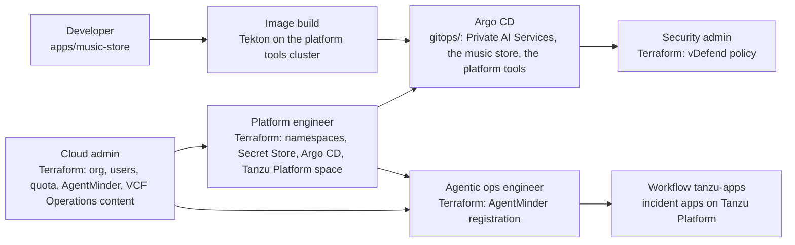

# The Grandmother of All Demos (GOAD)

GOAD shows VMware Cloud Foundation across an application's life, through
five personas: the cloud admin, the platform engineer, the agentic ops
engineer, the developer, and the security admin. Each persona builds its
part with its own tools, from this repository: Terraform, Argo CD, and
GitHub workflows.

The application is a music store, with an AI chat on Private AI Services.
Around it run an incident demo, with agents on Tanzu Platform registered
in AgentMinder, and a security demo, with vDefend guardrails in the
store's VKS cluster.

## Personas

| Persona | Tool | What it builds | Where |
|---|---|---|---|
| Cloud admin | Terraform | Stage 1: the org, VCF SSO, quota, networking, Avi load balancer, DSM policy | [terraform/cloud-admin/org](terraform/cloud-admin/org) |
| Cloud admin | Terraform | Stage 2: inside the org, the users and their roles, the Service Engine Group, and a project with a VKS cluster for AgentMinder | [terraform/cloud-admin/org-config](terraform/cloud-admin/org-config) |
| Cloud admin | Terraform | Stage 3: AgentMinder, installed on that cluster with Helm | [terraform/cloud-admin/agentminder](terraform/cloud-admin/agentminder) |
| Cloud admin | Terraform | VCF Operations content: platform observability dashboards and alerts | [terraform/cloud-admin/ops](terraform/cloud-admin/ops) |
| Platform engineer | Terraform | Supervisor Namespaces, the org's VM image, the secrets in Secret Store, Argo CD and the handoff to it, and the incident apps' Tanzu Platform space, `goad-qwen` and `k8s-mcp-cluster` | [terraform/platform-engineer](terraform/platform-engineer) |
| Platform engineer | Argo CD | A DSM PostgreSQL database, Private AI Services, and the Qwen model | [gitops/private-ai](gitops/private-ai) |
| Platform engineer | Argo CD | The shop's DSM catalog database, its VKS cluster, its users VM, and the endpoints that point the VKS cluster at the VM and at the catalog | [gitops/music-store](gitops/music-store) |
| Platform engineer | Argo CD | Inside the shop's VKS cluster: the ESO store, the Gateway certificate, and what the platform tools cluster watches it with | [gitops/music-store-platform](gitops/music-store-platform) |
| Platform engineer | Argo CD | The platform tools VKS cluster, and in it the incident demo's Zammad, Grafana and Prometheus | [gitops/platform-tools](gitops/platform-tools), [gitops/platform-tools-apps](gitops/platform-tools-apps) |
| Platform engineer | Argo CD | The shop's containers, on the VKS cluster, published through Gateway API with Avi's WAF | [gitops/music-store-apps](gitops/music-store-apps) |
| Platform engineer | Argo CD, GitHub workflow `music-store-images` | The build of the shop's images: Tekton on the platform tools cluster, and a pull request with the new image tags | [gitops/platform-tools-builds](gitops/platform-tools-builds), [.github/workflows/music-store-images.yml](.github/workflows/music-store-images.yml) |
| Agentic ops engineer | Terraform | The incident demo's agents and MCP servers registered in AgentMinder, their clients handed to the apps as Cloud Foundry services (`am-*`), and the agents' tool services (`sc-*`) | [terraform/agentic-ops](terraform/agentic-ops) |
| Agentic ops engineer | GitHub workflow `tanzu-apps` | The incident agents and MCP servers, as Cloud Foundry apps on Tanzu Platform | [tanzu/metal-music-app-agentic-system](tanzu/metal-music-app-agentic-system) |
| Developer | Code | The shop's source: store, cart, orders, and chat | [apps/music-store](apps/music-store) |
| Security admin | Terraform | The vDefend guardrails for the music store, pushed into its VKS cluster through Antrea. [docs/security-architecture.md](docs/security-architecture.md) shows every layer of the shop's security | [terraform/security-admin](terraform/security-admin) |

## How it fits together



An arrow means the first part is built before the second.
[docs/architecture.md](docs/architecture.md) has every resource and the
order between them.

## Build it

GOAD needs a VCF Automation 9.1 region on a Supervisor, with Avi, Data
Services Manager, Private AI Services, and a Tanzu Platform foundation.
[docs/build.md](docs/build.md) lists everything the lab needs, then builds
GOAD from an empty org, one persona at a time.

This repository names one lab's addresses and policies. To build GOAD in
another lab, change the lab values first: see
[docs/build.md](docs/build.md#things-to-know).

## Repository layout

```
terraform/cloud-admin/org/     Stage 1, provider (System) org scope: creates the org
terraform/cloud-admin/org-config/  Stage 2, inside the org: users, roles, Service Engine Group, kro-authors, AgentMinder's cluster
terraform/cloud-admin/agentminder/ Stage 3, AgentMinder on that cluster, with Helm
terraform/cloud-admin/ops/      VCF Operations content: platform observability dashboards (dashboards/*.json) and alerts
terraform/platform-engineer/   Inside the org: namespaces, Secret Store, Argo CD handoff, Tanzu Platform space
  manifests/                   Manifests that Terraform applies
terraform/agentic-ops/         The incident demo's agents registered in AgentMinder, and the am-* and sc-* services
terraform/runner/              The self-hosted runner for the workflows. Not a persona; applied by hand
gitops/<namespace key>/        What Argo CD syncs into that namespace: private-ai, music-store, platform-tools
gitops/music-store-platform/   The platform engineer's part inside the music-store VKS cluster
apps/music-store/              The developer's code: store, cart, order, chat. The platform engineer builds it into images
gitops/music-store-apps/       The shop's containers, deployed into the VKS cluster by the platform engineer, from the built images
gitops/platform-tools-builds/  The image build: Tekton pipeline, tasks, and the Dockerfile template, in the platform tools cluster
gitops/platform-tools-apps/    What runs in the platform tools cluster: the incident demo's Zammad, Grafana, Prometheus
tanzu/<space>/                 Cloud Foundry apps that tanzu-apps.yml pushes into that space of org Goad
scripts/                       What a person runs by hand: setup once, the SDK mirror, and the incident walk
demos/<demo>/                  One demo each: its run guide end to end, and the scripts the presenter runs
.github/workflows/             One Terraform workflow for each persona, tanzu-apps.yml, and music-store-images.yml
.github/actions/cf-login/      Installs the cf CLI and logs in to Tanzu Platform as goad-deployer
.github/actions/cf-token/      Gets a Tanzu Platform token for goad-deployer, for Terraform
docs/                          Design, script, plan, decisions
```

[CONTRIBUTING.md](CONTRIBUTING.md) says where a new file goes.

## Documents

### Understand it

| Document | What it is |
|---|---|
| [docs/architecture.md](docs/architecture.md) | What runs where, and the full automation flow |
| [docs/automation-walkthrough.html](docs/automation-walkthrough.html) | How the automation works, persona by persona, as a page to open in a browser. It shows each persona's ownership, including the agentic ops engineer's |
| [docs/security-architecture.md](docs/security-architecture.md) | The music store's security layers: who owns each, how it reaches the cluster, what traffic it decides |
| [docs/decisions.md](docs/decisions.md) | Choices made while building, and why |
| [CHANGELOG.md](CHANGELOG.md) | What changed, newest first |

### Build and run it

| Document | What it is |
|---|---|
| [docs/build.md](docs/build.md) | What the lab needs, and the first build, step by step |
| [docs/github-workflows.md](docs/github-workflows.md) | Running the Terraform roots and the app pushes from GitHub Actions |
| [docs/terraform-state.md](docs/terraform-state.md) | Where Terraform state is, the shared secret files, and how to set up a machine |
| [terraform/runner/README.md](terraform/runner/README.md) | The self-hosted runner that the workflows run on, and how to build it |

### Each part in detail

| Document | What it is |
|---|---|
| [terraform/cloud-admin/org/README.md](terraform/cloud-admin/org/README.md) | The cloud admin Terraform, stage 1 (the org), in detail |
| [terraform/cloud-admin/org-config/README.md](terraform/cloud-admin/org-config/README.md) | The cloud admin Terraform, stage 2 (inside the org), in detail |
| [terraform/cloud-admin/agentminder/README.md](terraform/cloud-admin/agentminder/README.md) | The cloud admin Terraform, stage 3 (AgentMinder), in detail |
| [terraform/cloud-admin/ops/README.md](terraform/cloud-admin/ops/README.md) | The cloud admin Terraform for VCF Operations content (dashboards and alerts) in detail |
| [terraform/platform-engineer/README.md](terraform/platform-engineer/README.md) | The platform engineer Terraform in detail |
| [terraform/agentic-ops/README.md](terraform/agentic-ops/README.md) | The agentic ops engineer Terraform (AgentMinder registration) in detail |
| [terraform/security-admin/README.md](terraform/security-admin/README.md) | The security admin Terraform (vDefend guardrails) in detail |
| [gitops/README.md](gitops/README.md) | Each gitops directory, its owner and Application, and how host names are published |
| [tanzu/metal-music-app-agentic-system/README.md](tanzu/metal-music-app-agentic-system/README.md) | The incident demo's Cloud Foundry apps, their secrets, and how to run a walk |

### Demos

| Document | What it is |
|---|---|
| [demos/README.md](demos/README.md) | The demos you can run on the built lab, each with its own run guide |

## License

[MIT](LICENSE).
