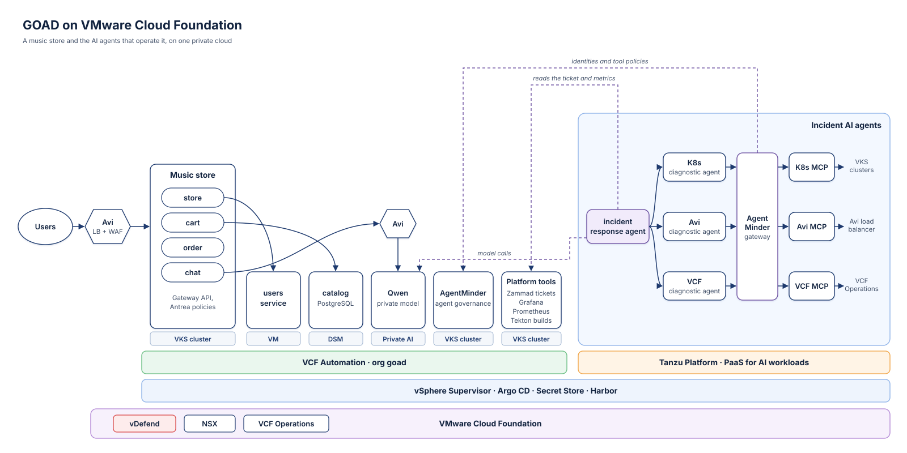

# The Grandmother of All Demos (GOAD)

GOAD shows VMware Cloud Foundation used the way it is meant to be: as a
true private cloud, centered on the applications that run on it. It uses
all of VCF's components together to run the different workload types
that a modern application needs, side by side in one platform:

- Containers on VKS clusters
- Virtual machines
- PostgreSQL databases from Data Services Manager
- A private AI model on Private AI Services
- A platform as a service for AI workloads on Tanzu Platform, where the
  AI agents run. Tanzu Platform's runtime is a VKS cluster: the apps
  pushed to it run there
- Governance for those agents in AgentMinder: their identities, and
  which tools each one may call
- Networking, load balancing, and security from NSX, vDefend, and Avi

The application is a music store with an AI chat. Its services, data,
and model each run on the workload type that fits them, and AI agents
built on the same platform help operate it.

Five personas share the platform: the cloud admin who runs the
infrastructure, the platform engineer who turns it into a product for
developers, the developer, the security admin, and the agentic ops
engineer who builds AI agents for operations. Each persona owns one
part and hands a defined set of things to the next. Every change starts in git. Terraform builds what has to exist
first, and Argo CD keeps everything else matching git. Nobody logs in to
a cluster to change things by hand. Because all of it is in this
repository, the lab can be rebuilt, and every change to it is reviewed.

## Personas

| Persona | Owns |
|---|---|
| Cloud admin | The organization, sign-in, capacity, networking, load balancer capacity, and AgentMinder as a core organization tool |
| Platform engineer | Namespaces, Argo CD, Kubernetes clusters, databases, the private AI model, the golden path, and the Tanzu Platform setup the agents run on |
| Developer | The music store's code, and nothing else |
| Agentic ops engineer | The incident AI agents, their tool servers, and the agents' identities in AgentMinder and which tools each agent may call |
| Security admin | Network guardrails in NSX and the web firewall |

[docs/architecture.md](docs/architecture.md#who-owns-what) lists what
each persona builds, with which tool, and where it is in this repository.

## How it fits together

Users reach the music store through Avi's load balancer and web firewall.
The store runs on a VKS cluster, with its users service on a VM, its
catalog in a DSM PostgreSQL database, and its chat on a private model in
Private AI Services. When something breaks, AI agents on Tanzu Platform,
running on its VKS runtime cluster, read the incident ticket and diagnose
it. Every tool call they make goes
through AgentMinder, which decides which agent may call which tool.

[docs/architecture.md](docs/architecture.md) has every resource behind it,
and how the automation builds them.

## Build it

GOAD needs a VCF Automation 9.1 region on a Supervisor, with Avi, Data
Services Manager, Private AI Services, and a Tanzu Platform foundation
with its runtime on a VKS cluster.
[docs/build.md](docs/build.md) lists everything the lab needs, then builds
GOAD from an empty org, one persona at a time.

This repository names one lab's addresses and policies. To build GOAD in
another lab, change the lab values first: see
[docs/build.md](docs/build.md#things-to-know).

## Documents

### Understand it

| Document | What it is |
|---|---|
| [docs/architecture.md](docs/architecture.md) | What runs where, and the full automation flow |
| [docs/automation-walkthrough.html](docs/automation-walkthrough.html) | How the automation works, persona by persona, as a page to open in a browser. It shows each persona's ownership, including the agentic ops engineer's |
| [docs/architecture-explorer.html](docs/architecture-explorer.html) | The whole GOAD architecture from the hosts up, as one drawing in layers: vSphere, NSX VPCs on the distributed transit gateway, Avi, the Supervisor, the org and its namespaces, and what runs in them. Pick a persona to light what they build, or peel off layers. A page to open in a browser |
| [docs/security-architecture.md](docs/security-architecture.md) | The music store's security layers: who owns each, how it reaches the cluster, what traffic it decides |
| [docs/decisions.md](docs/decisions.md) | Choices made while building, and why |
| [CHANGELOG.md](CHANGELOG.md) | What changed, newest first |

### Build and run it

| Document | What it is |
|---|---|
| [docs/build.md](docs/build.md) | What the lab needs, and the first build, step by step |
| [docs/github-workflows.md](docs/github-workflows.md) | Running the Terraform roots and the app pushes from GitHub Actions |
| [CONTRIBUTING.md](CONTRIBUTING.md) | The repository layout, and where a new file goes |
| [docs/terraform-state.md](docs/terraform-state.md) | Where Terraform state is, the shared secret files, and how to set up a machine |
| [terraform/runner/README.md](terraform/runner/README.md) | The self-hosted runner that the workflows run on, and how to build it |

### Each part in detail

| Document | What it is |
|---|---|
| [terraform/cloud-admin/org/README.md](terraform/cloud-admin/org/README.md) | The cloud admin Terraform, stage 1 (the org), in detail |
| [terraform/cloud-admin/org-config/README.md](terraform/cloud-admin/org-config/README.md) | The cloud admin Terraform, stage 2 (inside the org), in detail |
| [terraform/cloud-admin/agentminder/README.md](terraform/cloud-admin/agentminder/README.md) | The cloud admin Terraform, stage 3 (AgentMinder), in detail |
| [terraform/cloud-admin/ops/README.md](terraform/cloud-admin/ops/README.md) | The cloud admin Terraform for VCF Operations content (dashboards and alerts) in detail |
| [terraform/platform-engineer/README.md](terraform/platform-engineer/README.md) | The platform engineer Terraform in detail |
| [terraform/agentic-ops/README.md](terraform/agentic-ops/README.md) | The agentic ops engineer Terraform (AgentMinder registration) in detail |
| [terraform/security-admin/README.md](terraform/security-admin/README.md) | The security admin Terraform (vDefend guardrails) in detail |
| [gitops/README.md](gitops/README.md) | Each gitops directory, its owner and Application, and how host names are published |
| [tanzu/metal-music-app-agentic-system/README.md](tanzu/metal-music-app-agentic-system/README.md) | The incident demo's Cloud Foundry apps, their secrets, and how to run a walk |

### Demos

| Document | What it is |
|---|---|
| [demos/README.md](demos/README.md) | The demos you can run on the built lab, each with its own run guide |

## License

[MIT](LICENSE).
