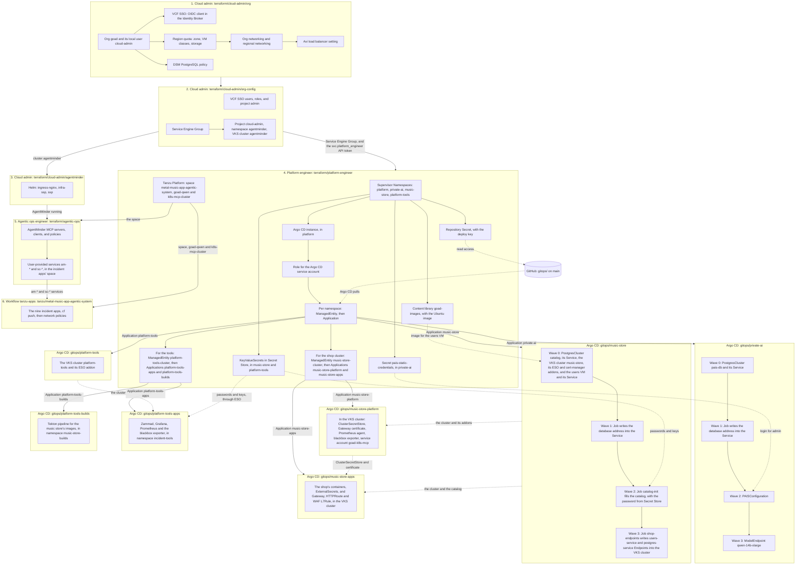

# Architecture

What runs where, and the order the automation builds it in.

## What runs where

The music-store application, manifests and source, is in
[gitops/music-store-apps](../gitops/music-store-apps). The developer
writes the application code in [apps/music-store](../apps/music-store). The
developer does not build or deploy it. The platform engineer builds the
images with Tekton on the platform tools cluster. The platform engineer deploys all of the music store with Argo CD:
the VKS cluster `music-store`, the catalog database, the users VM, and
the containers on that cluster (decision 45).

[gitops/music-store](../gitops/music-store) is the DSM catalog, the VKS
cluster `music-store`, and the users VM. A Job writes the VM's address
and the catalog's address into Endpoints in the VKS cluster. No file
sets a namespace or an address. Terraform creates the `music-store`
namespace with the others, and Argo CD syncs that directory into it. The catalog Service is
`postgres-service`, which is the `DB_HOST` the containers already use.

[gitops/music-store-apps](../gitops/music-store-apps) is the application
and its deploy. It goes into the namespace `music-store` of the VKS
cluster. It is the store, cart, orders, and chat, from the images the
platform engineer builds from `apps/music-store/`. The platform engineer
owns the build and the deploy, and the developer owns
`apps/music-store/`. The catalog password and the chat's model key are not in git.
They are GitHub secrets, which the platform engineer Terraform writes
into Secret Store; ESO in the cluster makes the Secrets `store-db` and
`metal-oracle-model` from them (decision 38).

[gitops/music-store-platform](../gitops/music-store-platform) is the platform
engineer's part inside the VKS cluster: the `ClusterSecretStore` that ESO
reads Secret Store with, the self-signed wildcard certificate for the
shop's Gateway (decision 43), and the Prometheus agent and service account
the platform tools cluster uses to watch the shop.

The shop is published at `music.goad.gpu.set.lab` through Gateway API: the
Gateway `metal-store`, the HTTPRoute `metal-store-frontend`, and the
L7Rule `metal-store-waf`, which puts Avi's WAF policy on the route.

The incident demo's tools run on their own VKS cluster, `platform-tools`,
apart from the cluster they watch (decision 42).
[gitops/platform-tools](../gitops/platform-tools) is the cluster, and
[gitops/platform-tools-apps](../gitops/platform-tools-apps) is Zammad,
Grafana, Prometheus and the blackbox exporter in it. The incident apps
themselves are Cloud Foundry apps in
[tanzu/metal-music-app-agentic-system](../tanzu/metal-music-app-agentic-system),
and `scripts/incident-walk.sh` starts a walk.

## Automation flow

Five Terraform roots, from a machine or from GitHub, then Argo CD and the
`tanzu-apps` workflow. An arrow means the first box is done before the
second one starts.

Solid arrows are that order. Dotted arrows are what one part reads from
another. After the handoff, Terraform does not touch what runs in
`private-ai`, `music-store`, `platform-tools`, and the clusters
`music-store` and `platform-tools`: a commit to `gitops/` on `main` is the
change.

`terraform/agentic-ops` needs the space that the platform engineer makes
and the AgentMinder that the cloud admin installs, so it runs after both.
