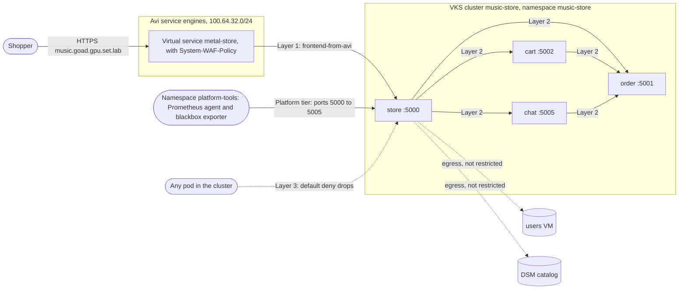
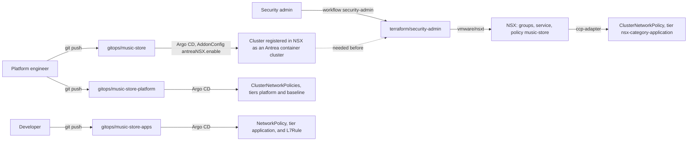

# Security architecture

How the music store is secured: who owns each policy, where it is
written, how it reaches the cluster, and which traffic it decides. The
reasons are in [decision 49](decisions.md) (layered network policy) and
[decision 43](decisions.md) (Gateway API and the WAF).

## The picture

Solid arrows are allowed flows, labelled with the layer that allows them.
Dotted arrows are flows that no layer allows, or that no policy covers.
The SQL and PHP injection that the WAF stops never leave Avi, so they
have no arrow into the cluster.

## The layers

Antrea enforces every network policy on the cluster, including the
vDefend policy from NSX. Antrea evaluates tiers in order, and **the
first rule that matches a flow decides it**. Later tiers never see that
flow.

| Order | Antrea tier | Layer | Owner | Written in | Reaches the cluster through |
|---|---|---|---|---|---|
| 1 | `nsx-category-application` (4) | 1. Guardrails | Security admin | [terraform/security-admin](../terraform/security-admin) | Terraform to NSX, then NSX's ccp-adapter as an Antrea ClusterNetworkPolicy |
| 2 | `platform` (200) | Platform monitoring | Platform engineer | [gitops/music-store-platform/network-policy.yaml](../gitops/music-store-platform/network-policy.yaml) | Argo CD |
| 3 | `application` (250) | 2. Service to service | Developer | [gitops/music-store-apps/network-policy.yaml](../gitops/music-store-apps/network-policy.yaml) | Argo CD |
| 4 | `baseline` (253) | 3. Default deny | Platform engineer | [gitops/music-store-platform/network-policy.yaml](../gitops/music-store-platform/network-policy.yaml) | Argo CD |

In front of all of them is the Avi WAF. It inspects HTTP before the
traffic reaches the cluster, so a blocked request never meets a network
policy.

### Layer 1: guardrails (security admin, vDefend)

The flows the security admin mandates, whatever the developer writes.
One rule today:

| Rule | From | To | Port | Action |
|---|---|---|---|---|
| `frontend-from-avi` | Avi service engine data network, `frontend_source_cidrs` | Group `music-store-store` | TCP 5000 | Allow, logged |

The layer holds allow rules only. A catch-all drop in this tier would
decide every flow before the developer's tier, so no developer rule could
ever allow anything. An allow here cannot be undone by a later tier: the
developer cannot cut the shop off from Avi.

AKO uses NodePortLocal, so the traffic keeps the service engine's address
as its source. The rule needs no node addresses, and scaling the cluster
changes nothing.

The NSX groups `music-store-store`, `-cart`, `-order` and `-chat` select
pods in namespace `music-store` by three labels on the pod templates:
`app-name: music-store`, `env: prod`, and `service-name: <service>`. NSX
sees Kubernetes labels as tags of the form `dis:k8s:<key>|<value>`.

Never edit the pushed ClusterNetworkPolicy with `kubectl`. The
ccp-adapter puts it back.

### Platform tier: monitoring (platform engineer)

The platform's own tools must keep reaching the shop whatever the
developer writes. The ClusterNetworkPolicy
`music-store-platform-monitoring` allows namespace `platform-tools` (on
the music store cluster) to reach every pod in `music-store` on TCP 5000
to 5005. This is the Prometheus agent and the blackbox exporter that
feed the platform tools cluster.

### Layer 2: service to service (developer)

The shop's own calls, in a namespaced Antrea NetworkPolicy
`music-store-service-to-service`. Namespaced, so the developer needs no
cluster-wide rights, and its selectors only match pods in `music-store`.

| Rule | From | To | Port |
|---|---|---|---|
| `store-to-cart` | store | cart | TCP 5002 |
| `store-cart-and-chat-to-order` | store, cart, chat | order | TCP 5001 |
| `store-to-chat` | store | chat | TCP 5005 |

All three are allow rules, logged. The policy covers ingress only.

### Layer 3: default deny (platform engineer)

The ClusterNetworkPolicy `music-store-default-deny` drops all ingress to
pods in `music-store`, logged. It sits in `baseline`, the last tier, so
it never shadows another layer: it decides only what no one else
decided.

A node always reaches its own pods, so kubelet probes still work.

### The WAF (Avi)

The L7Rule `metal-store-waf` in
[gitops/music-store-apps](../gitops/music-store-apps) puts Avi's built-in
`System-WAF-Policy` (the OWASP CRS template) on the HTTPRoute
`metal-store-frontend`. The policy must be in enforcement mode in Avi to
answer 403. In detection mode it only logs.

## How it is delivered

Order matters once, on a new build. NSX pushes policy into the cluster
only after the cluster is registered as an Antrea container cluster.
[gitops/music-store/antrea-nsx.yaml](../gitops/music-store/antrea-nsx.yaml)
turns that on in wave 0, and the Supervisor does the NSX side. So the
`security-admin` workflow runs after the platform engineer's. It plans
on demand, and applies only from `main` with "apply" ticked. Its
Terraform finds the cluster in NSX by name pattern and stops with an
error if the integration is off.

## What the pen test proves

The pen test runs five checks against the shop, in two forms: an
attacker pod started by hand ([demos/pen-test-manual](../demos/pen-test-manual)),
and an always-on blackbox exporter in namespace `pen-test`
([pen-test.yaml](../gitops/music-store-platform/pen-test.yaml)) whose
results are the Grafana board "Pen test" ([demos/pen-test-dashboard](../demos/pen-test-dashboard)). Namespace `pen-test` is allowed
nothing, so it sees what any other pod sees. A probe from
`platform-tools` would pass the platform tier's allow and prove nothing.

| # | Check | Expected | Decided by |
|---|---|---|---|
| 1 | The store pod's IP, around Avi | No answer | Layer 3, default deny |
| 2 | The store's Service, around Avi | No answer | Layer 3, default deny |
| 3 | SQL injection through Avi | HTTP 403 | Avi WAF |
| 4 | PHP injection through Avi | HTTP 403 | Avi WAF |
| 5 | A clean request through Avi | HTTP 200 | Layer 1, `frontend-from-avi` |

## Other controls

Not network policy, but part of the same picture:

- **Secrets.** Passwords and keys are GitHub secrets. The platform
  engineer's Terraform writes them into Secret Store, and ESO in the
  cluster makes Kubernetes Secrets from them. None is in git
  ([decision 38](decisions.md)).
- **TLS.** The Gateway serves a self-signed wildcard certificate from
  cert-manager ([decision 43](decisions.md)).
- **Agent tools.** AgentMinder policies decide which incident agent may
  call which MCP server's tools
  ([terraform/cloud-admin/agentminder-registration](../terraform/cloud-admin/agentminder-registration)).
- **Tanzu Platform apps.** The incident apps reach each other only
  through `cf add-network-policy` rules, set by the `tanzu-apps`
  workflow.

## Not covered

- **Egress.** No layer restricts traffic out of `music-store`. The calls
  to the users VM and the DSM catalog leave the cluster unchecked.
- **The users VM and the catalog.** They are not pods, so they have no
  Antrea group. vDefend DFW on the users VM is not built.
- **vDefend SSP** (anomaly detection, for the security incident video)
  is not built.
- **Pod Security admission.** GOAD sets no Pod Security labels on
  `music-store`; the cluster's default applies.
